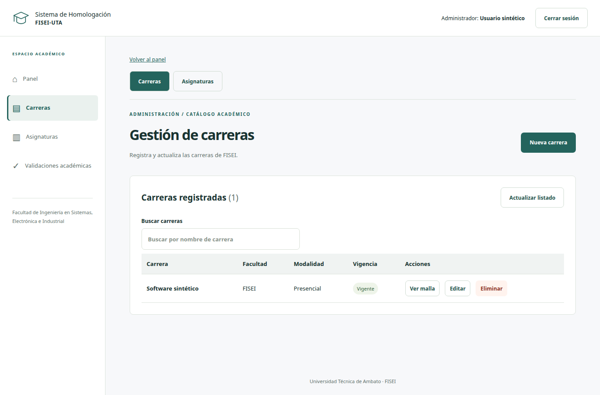
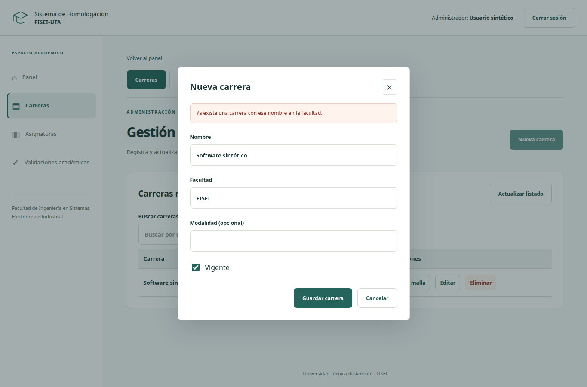
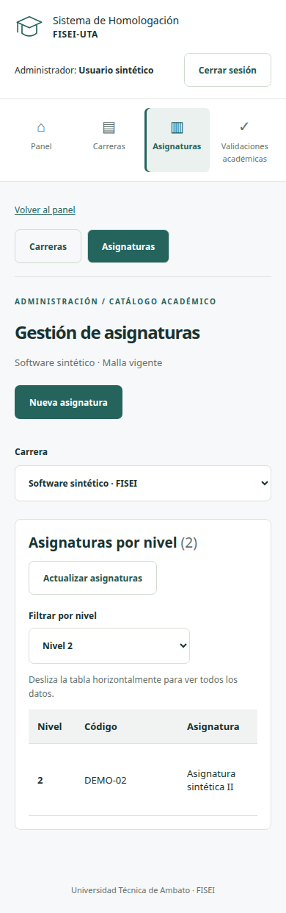

# Evidencia técnica — adaptación a mockups

Fecha: 21/10/2026. Rama: `feature/hu-01-refactor-mockups`.
Issues: #1 (login/panel), #2 (carreras), #3 (asignaturas), #4 (presentación de unidades),
#5–7 (estructura común de validaciones). Fuente visual: dos PNG del ZIP local
`Docs/Homologación FISEI.zip`. Continuación y commits autorizados por el usuario.

## Implementación

- Login central, identidad académica y error destacado, conservando usuario/JWT en memoria.
- Cabecera y navegación compartidas, entradas de carreras/asignaturas y permisos según rol.
- Búsqueda de carreras; alta/edición en modal; duplicados dentro del formulario;
  error de eliminación en ventana con botón Entendido.
- Acceso a la malla desde la fila de carrera; selección conservada en query string;
  filtro por nivel y alta de asignaturas en modal.
- Estilos comunes para unidades y validaciones, sin cambiar sus contratos ni reglas.
- Modales con foco inicial, Tab/Shift+Tab, Escape y retorno de foco. Ajuste específico
  para la repetición de efectos de React StrictMode.
- Tablas desplazables en móvil y columnas de nivel/código legibles.

Los números de ejemplo, usuarios/roles, docentes, carga masiva, parámetros y nuevas
solicitudes del wireframe no se simulan como funciones disponibles. Se conserva
FISEI fija y no se incorpora «Recordarme» ni autenticación por correo.

## Comprobaciones realizadas

| Comprobación | Resultado |
|---|---|
| `npm run build` | TypeScript y Vite correctos, también dentro de Docker |
| `npm test -- --reporter=dot` | 92 pruebas aprobadas, 11 archivos |
| TDD búsqueda/modal/filtro | 2 fallos iniciales en carreras y 1 en asignaturas; luego aprobados |
| `npm run test:mockups` | 6 recorridos correctos con API simulada: 1365, 390 y 320 px |
| E2E reales | 4 recorridos correctos, escritorio/móvil, sobre Nginx → Gateway → servicios → SQL Server |
| Revisión visual | Capturas inspeccionadas; corregidos foco, ancho de códigos y ocultamiento del enlace de salto fuera de foco |
| `git diff --check` | Sin errores |

El E2E real verifica errores de login, JWT, recarga/logout, FISEI fija, alta/edición
de carrera, registro de asignatura, rechazo de valores no positivos, rechazo de
borrado con asignaturas y lectura móvil sin desbordamiento de página.
La suite simulada verifica además búsqueda, error de duplicado, ciclo de foco,
Escape, malla contextual, filtro, consulta de unidades y enlaces por rol.
No se ejecutaron nuevamente las suites .NET: los servicios no fueron modificados.

El stack aislado se construyó con `compose.sprint1.yaml`, proyecto
`fisei-ui-refactor`, volumen propio y datos sintéticos. No se usaron las bases de
demostración existentes. Configuración privada temporal en `/tmp/fisei-ui-refactor.env`
con permisos 0600, nunca versionada. Frontend de prueba: `http://127.0.0.1:5180`.
El último ajuste de ocultamiento del enlace de salto es exclusivamente CSS y se
verificó en los seis recorridos visuales posteriores a los E2E integrados.

Para repetir la integración con ese stack:

```sh
cd frontend
node scripts/run-e2e.mjs /tmp/fisei-ui-refactor.env
```

## Capturas con datos sintéticos







## Pendientes humanos

Revisión cruzada, PR hacia develop y aceptación funcional de Shirley. No se hizo
push, merge ni cierre de Issues. Esta evidencia no sustituye la aceptación del
Sprint ni acredita funcionalidades de sprints posteriores.
