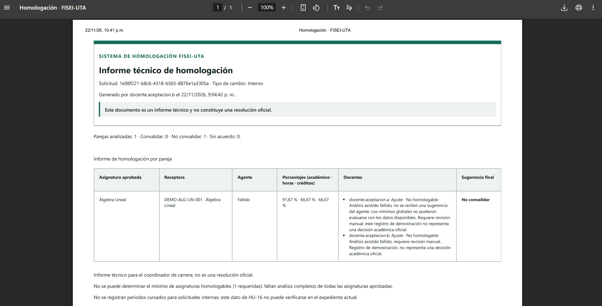

# Evidencia HU-24 — exportar informe a PDF

Issue #72 · rama `feature/hu-24-informe-pdf` · fecha: 15/11/2026.

## Implementación

- Botón de exportación en los paneles de docente y coordinación, solo cuando el informe fijo ya existe.
- Impresión nativa del navegador con estilos A4 horizontal; la persona guarda el resultado como PDF desde el diálogo.
- Se imprime únicamente el informe: fecha/autor, parejas, agente, porcentajes, ambos docentes, sugerencias, asignaturas sin análisis y advertencias. Incluye la advertencia de que es un informe técnico y no una resolución oficial.
- El coordinador puede consultar solicitudes FISEI existentes según la decisión de Shirley, Product Owner, del 15/11/2026. La consulta interna entrega contexto académico mínimo. La generación continúa restringida a los docentes asignados.
- Swagger expone la documentación de HU-23/HU-24 y las reglas de acceso actualizadas.

## Verificación automatizada

- Frontend: `npm run build` correcto; Vitest aprobó **145 pruebas en 21 archivos**.
- Homologación API: `dotnet test tests/Homologacion.Api.Tests/Homologacion.Api.Tests.csproj -c Release --no-restore` — **133 aprobadas, 0 fallidas**.
- Solicitudes: `dotnet test tests/Solicitudes.Tests/Solicitudes.Tests.csproj -c Release --no-restore` — **141 aprobadas, 0 fallidas, 5 omitidas**. Las omitidas requieren el SQL Server aislado (`HU10_TEST_SQL`).
- Las pruebas específicas cubren consulta de Coordinación, docente no asignado, ausencia del informe, rol sin permiso, ocultación del botón antes de generar y ejecución de impresión.

## Verificación manual de exportación — 22/11/2026

- Se abrió la solicitud de demostración finalizada `DEMO-HU37-01` en el entorno local con Docker Compose.
- Al pulsar **Exportar informe a PDF**, el navegador mostró la vista previa nativa en la misma pestaña, sin abrir una pestaña intermedia.
- La vista previa contiene el encabezado verde, el informe y la tabla completa en una página (1/1); las columnas se leen sin cortar palabras ni duplicar filas.
- Captura proporcionada por Shirley durante la comprobación:

## Pendiente para la Definición de Hecho

- Revisión cruzada de la PR y confirmación de CI remoto.
- Aceptación formal de HU-24 por Shirley después de la revisión cruzada.

La captura documenta la vista previa manual; no declara la historia integrada ni sustituye la revisión cruzada.

